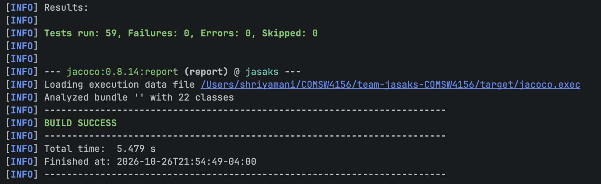
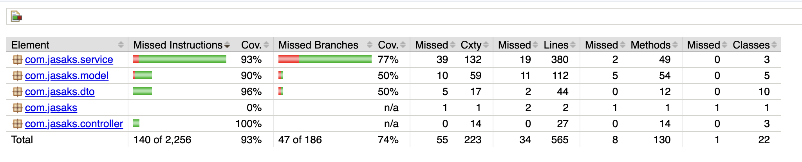
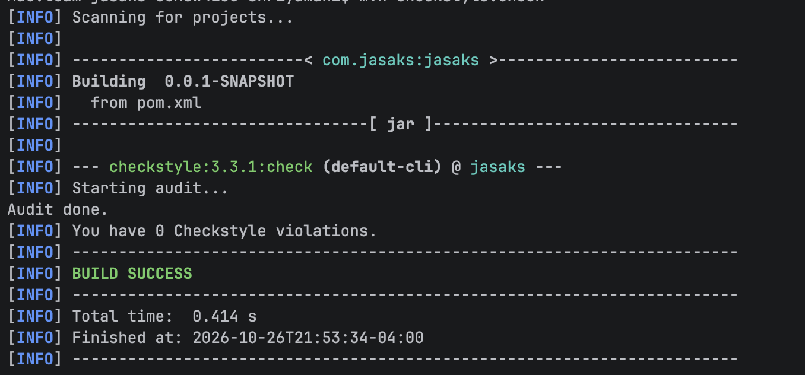

# Space Management Tool #

COMSW4156 Advanced Software Engineering

**Group Members**: Alyssa King, Annie Wang, Janice Wong, Karin Novelia, Shobini Iyer, Shriya Mani

### Overview
This general-purpose space booking/reservation service will allow client programs to find, reserve, modify and cancel reservations for different spaces. The service is responsible for preventing overlapping reservations, checking that a space can accommodate the requested amount of people and ranking spaces based on a booker’s preferences, and optimally calculating reservation prices based on the space, duration, capacity, or pricing rules. It can also provide usage reports showing metrics like space utilization, space assignments, average reservation duration, peak booking time, and revenue for paid places. The service will maintain its own datastore of spaces, clients, and reservations.

### Skeleton Code ###

This repository was bootstrapped using the website https://start.spring.io/.
Initializr is a tool that generates a SpringBoot project using the user provided
customizations. Users configure the build automation tool they want to use, the
project language, SpringBoot version, project metadata and any dependencies.

Customizations:
- **Project**: Maven
- **Language**: Java
- **SpringBoot**: 4.1.2
- **Java**: 17
- **Dependencies**: SpringWeb, Spring JPA, Validation, PostgreSQL Driver, H2 Database

### Database Setup ###
This project uses PostgreSQL when testing locally, and an in-memory H2 database when running tests.

#### Local Testing ####
When testing locally, a Docker Postgre SQL database is spun up and ensures each person has their own copy of the DB to test and modify, but the structure will be the same for each person.

| Situation | Database | Config file |
|---|---|---|
| Running the service (`mvn spring-boot:run`) | PostgreSQL 17 in Docker | `src/main/resources/application.properties` |
| Running tests (`mvn test`) | H2 (in memory) | `src/test/resources/application.properties` |

**Prerequisite:** [Docker Desktop](https://www.docker.com/products/docker-desktop/) installed and running.

**Start the database:**
```bash
docker compose up -d
```

**Run the service** (Hibernate creates or updates the tables from the entity classes on startup):
```bash
mvn spring-boot:run
```

**Other commands:**

| Command | What it does |
|---|---|
| `docker compose ps` | Check that the `jasaks-postgres` container is running |
| `docker compose stop` | Stop the database (data is kept) |
| `docker compose down -v` | Delete the database **and all its data**, for a clean reset |
| `docker exec -it jasaks-postgres psql -U jasaks -d jasaks` | Open a SQL prompt inside the database |

#### How `docker-compose.yaml` is configured

| Setting | Purpose |
|---|---|
| `services: postgres` | Defines a single container running the database. |
| `image: postgres:17` | Pins the Postgres version so everyone runs the same one. |
| `container_name: jasaks-postgres` | Gives the container a fixed name, so the same `docker` commands work on every machine. |
| `POSTGRES_DB`, `POSTGRES_USER`, `POSTGRES_PASSWORD` | Create the `jasaks` database and login the first time the container starts. These must match `spring.datasource.*` in `src/main/resources/application.properties`. |
| `ports: "5433:5432"` | Maps port 5433 on local machine to Postgres's default port 5432 inside the container.|
| `volumes` (both blocks) | Keep the data when the container restarts. The top-level `volumes:` block declares a named storage area (`jasaks-data`); the one under the service attaches it to Postgres's data folder. |

The database connection settings in `application.properties` can be overridden with the `DB_URL`, `DB_USER` and `DB_PASSWORD` environment variables, e.g. to point at a cloud database instead.

### Tests (H2 in-memory database)

`mvn test` runs against **H2**, an in-memory database that starts with the tests and disappears when the tests finish.
Each test run starts with an empty database, creates the tables from the entity classes, and inserts whatever data that test needs.

## Data Model

Entities live in `src/main/java/com/jasaks/model/`. Each one maps to a database table, which Hibernate creates automatically from the class.

| Entity | Table | Key fields | Notes |
|---|---|---|---|
| `Place` | `places` | `placeId`, `placeName`, `timeZone`, `openTime`, `closeTime`, `refundHours`, `refundPercent` | A building or venue. Holds the operating hours and cancellation policy shared by all its spaces. |
| `Space` | `spaces` | `spaceId`, `place`, `spaceName`, `capacity`, `hourlyRate`, `amenities` | A bookable room inside a Place. Amenities are stored in a separate `space_amenities` table. |
| `Booker` | `bookers` | `bookerId`, `name` | Who a reservation is for. The `bookerId` is supplied by the client program, not generated. |
| `Reservation` | `reservations` | `reservationId`, `booker`, `space`, `startTime`, `endTime`, `groupSize`, `price`, `status`, `createdAt` | Links a Booker to a Space for a time window. |

**Relationships:** a Place has many Spaces; a Space has many Reservations; a Booker has many Reservations. These are `@ManyToOne` links, stored as the foreign keys `place_id`, `space_id` and `booker_id`.

**Reservation status** (`ReservationStatus`): `CONFIRMED`, `COMPLETED` or `CANCELLED`. Cancelled reservations are kept rather than deleted, so reports keep the history.

### Time conventions
- `startTime`, `endTime`, `openTime` and `closeTime` are in the **place's local time zone** (`Place.timeZone`, e.g. `America/New_York`). Clients in other time zones must convert before calling the API.
- Any check against the current time uses the place's zone: `LocalDateTime.now(ZoneId.of(place.getTimeZone()))`, never the server's clock.
- `createdAt` is an `Instant`, an exact moment independent of time zone, and is set automatically when the reservation is first saved.
- Money (`hourlyRate`, `price`) is stored as `BigDecimal` with 2 decimal places.

## Repositories

Repositories live in `src/main/java/com/jasaks/repository/`. Each one extends Spring Data's `JpaRepository`, which provides `save`, `findById`, `findAll`, `existsById` and `deleteById` with no code. Spring generates the implementations at startup.

| Repository | Custom methods |
|---|---|
| `PlaceRepository` | none |
| `BookerRepository` | none |
| `SpaceRepository` | `findByPlace_PlaceId(placeId)`: all spaces in a place |
| `ReservationRepository` | `hasOverlap(spaceId, start, end)`: whether any non-cancelled reservation on the space overlaps the window. Used by Create and Search. |
| | `hasOverlapExcluding(spaceId, start, end, excludeId)`: the same check, ignoring one reservation. Used by Modify, so a reservation doesn't conflict with itself. |
| | `findByBookerBookerId(bookerId)`: all of a booker's reservations |
| | `findActiveReservationsInWindow(spaceId, start, end)`: non-cancelled reservations overlapping a window. Used by the space report. |
| | `existsBySpaceSpaceId(spaceId)`: whether a space has any reservations. Blocks deleting it. |

**Overlap rule:** two time ranges overlap when each one starts before the other ends (`existing.start < new.end AND existing.end > new.start`). Back-to-back bookings, such as 10:00–12:00 followed by 12:00–13:00, do **not** overlap.

## Endpoints

The service runs on `http://localhost:8080` by default. All request and response bodies are JSON.

**Common conventions**
- **Times** use ISO-8601 local date-times with no offset (`YYYY-MM-DDTHH:mm`, e.g. `2026-12-01T10:00`). They are read in the **place's time zone** (see [Time conventions](#time-conventions)).
- **Error responses** use Spring's RFC 7807 Problem Details format (`spring.mvc.problemdetails.enabled=true`):
  ```json
  { "type": "about:blank", "title": "Not Found", "status": 404, "detail": "Space not found: 99", "instance": "/api/spaces/99" }
  ```
- **400 Bad Request** is also returned automatically by Spring for any endpoint when a path or query parameter has the wrong type (e.g. `/api/spaces/abc`), a required query parameter is missing, the JSON body is malformed, or a body field fails its validation annotation.

| # | Method | Path | Purpose |
|---|---|---|---|
| 1 | `GET` | `/api/spaces` | [List spaces](#1-list-spaces) |
| 2 | `GET` | `/api/spaces/{spaceId}` | [Get space by ID](#2-get-space-by-id) |
| 3 | `POST` | `/api/spaces` | [Create space](#3-create-space) |
| 4 | `PUT` | `/api/spaces/{spaceId}` | [Update space](#4-update-space) |
| 5 | `DELETE` | `/api/spaces/{spaceId}` | [Delete space](#5-delete-space) |
| 6 | `GET` | `/api/reservations` | [List user reservations](#6-list-user-reservations) |
| 7 | `POST` | `/api/reservations/{id}/cancel` | [Cancel reservation](#7-cancel-reservation) |
| 8 | `GET` | `/api/spaces/search` | [Search available spaces](#8-search-available-spaces) |
| 9 | `GET` | `/api/reports/spaces` | [Space utilization report](#9-space-utilization-report) |
| 10 | `POST` | `/api/reservations` | [Create reservation](#10-create-reservation) |
| 11 | `PATCH` | `/api/reservations/{reservationId}` | [Modify reservation](#11-modify-reservation) |

---

### 1. List Spaces

**Endpoint:** `GET /api/spaces`

- **Input:**
    - Optional query parameter: `placeId` (Long)
    - If omitted, returns all spaces.
    - If provided, returns only spaces belonging to that place.
- **Side effect:** None. The operation is read-only.
- **Output:** A JSON array of `SpaceResponse` objects, containing fields such as `spaceId`, `placeId`, `placeName`, `spaceName`, `capacity`, `hourlyRate`, and `amenities`.
- **Status codes:**
    - `200 OK`: Successfully retrieves the spaces.
    - `400 Bad Request`: An invalid `placeId` format.

**Example requests:**
```http
GET /api/spaces
GET /api/spaces?placeId=1
```

---

### 2. Get Space by ID

**Endpoint:** `GET /api/spaces/{spaceId}`

- **Input:**
    - Path parameter: `spaceId` (Long)
- **Side effect:** None. The operation is read-only.
- **Output:** A single `SpaceResponse` JSON object.
- **Status codes:**
    - `200 OK`: Space exists and is returned.
    - `404 Not Found`: No space exists with the specified ID.
    - `400 Bad Request`: The path parameter cannot be parsed as a Long.

---

### 3. Create Space

**Endpoint:** `POST /api/spaces`

- **Input:** JSON request body (`SpaceRequest`). Example:
  ```json
  {
    "placeId": 1,
    "spaceName": "Room A",
    "capacity": 8,
    "hourlyRate": 25.50,
    "amenities": ["wifi", "whiteboard"]
  }
  ```
- **Side effects:**
    - Looks up the associated place.
    - Creates a new Space associated with that place.
    - Saves the space to the database.
- **Output:** The created `SpaceResponse`, including its generated `spaceId` and associated place information.
- **Status codes:**
    - `201 Created`: Space successfully created.
    - `400 Bad Request`: Request payload is invalid, such as an empty name, nonpositive capacity, or negative hourly rate.
    - `404 Not Found`: The specified `placeId` does not exist.

---

### 4. Update Space

**Endpoint:** `PUT /api/spaces/{spaceId}`

- **Input:**
    - Path parameter: `spaceId` (Long)
    - JSON request body (`SpaceRequest`), containing `placeId`, `spaceName`, `capacity`, `hourlyRate`, and `amenities`.
- **Side effects:**
    - Looks up the existing space.
    - Looks up the new or existing associated place.
    - Replaces the space's place, name, capacity, hourly rate, and amenities.
    - Saves the updated space to the database.
- This is a **full replacement** of the fields represented in `SpaceRequest`, rather than a partial update.
- **Output:** The updated `SpaceResponse`.
- **Status codes:**
    - `200 OK`: Space successfully updated.
    - `400 Bad Request`: Invalid request payload or malformed ID.
    - `404 Not Found`: The space ID or referenced place ID does not exist.

---

### 5. Delete Space

**Endpoint:** `DELETE /api/spaces/{spaceId}`

- **Input:**
    - Path parameter: `spaceId` (Long)
- **Side effects:**
    - Looks up the space.
    - Checks whether any reservations reference that space.
    - If reservations exist, rejects the deletion.
    - Otherwise, deletes the space from the database.
- **Output:** No response body.
- **Status codes:**
    - `204 No Content`: Space successfully deleted.
    - `404 Not Found`: Space does not exist.
    - `409 Conflict`: Space has existing reservations and cannot be deleted.
    - `400 Bad Request`: Malformed `spaceId`.

---

### 6. List User Reservations

**Endpoint:** `GET /api/reservations`

- **Input** (query parameters):
    - `userId`: The ID of the booker whose reservations are being queried.
    - `startDate` (optional): Start of the date/time range.
    - `endDate` (optional): End of the date/time range.
    - `placeId` (optional): Filter reservations by the place ID.
    - `spaceId` (optional): Filter reservations by specific space ID.
- **Output:**
    - JSON array of `ReservationResponse` objects.
- **Side effect:** None. This is a read-only query operation.
- **Status codes:**
    - `200 OK`: Request succeeded. Returns matching reservations, or an empty list if no reservations match.
    - `400 Bad Request`: Returned if `userId` is missing, empty, or whitespace, or if `startDate` is chronologically after `endDate`, or if date parameters cannot be parsed as ISO-8601 timestamps.

**Example request:**
```http
GET /api/reservations?userId=B123&startDate=2026-12-01T00:00&endDate=2026-12-31T23:59&placeId=1
```

---

### 7. Cancel Reservation

**Endpoint:** `POST /api/reservations/{id}/cancel`

**Example query:** `POST /api/reservations/42/cancel?bookerId=B123`

- **Input:**
    - `id`: the reservation ID (Long, path parameter)
    - `bookerId`: the ID of the booker who wants to cancel the reservation (String, query parameter)
- **Output:** On success, it returns a `CancellationResponse` containing:
    - `reservationId`: the ID of the reservation that was cancelled
    - `status`: the updated status of the reservation (`CANCELLED`)
    - `refundAmount`: the amount that was refunded to the user
    - `cancelledAt`: the time that the reservation was successfully cancelled
    - `refundExplanation`: explanation of how the refund was calculated
- **Side effects:**
    - Updates the reservation status from `CONFIRMED` to `CANCELLED`.
    - Records the cancellation timestamp and stores the calculated refund amount.
    - Saves the updated reservation to the database.
- **Status codes:**
    - `200 OK`: Reservation was cancelled successfully.
    - `403 Forbidden`: `bookerId` of the reservation doesn't match the ID of the user trying to cancel the reservation.
    - `404 Not Found`: Reservation doesn't exist.
    - `409 Conflict`: Reservation has already been cancelled, isn't confirmed, or has already started.

---

### 8. Search Available Spaces

**Endpoint:** `GET /api/spaces/search`

- **Input** (query parameters):
    - `placeName`: name of the place to search for spaces in (String)
    - `startTime`: start time for desired reservation (String in `YYYY-MM-DDTHH:mm` format)
    - `endTime`: end time for desired reservation (String in `YYYY-MM-DDTHH:mm` format)
    - `minCapacity`: minimum number of people the space must hold (Integer)
    - `amenities` (optional): amenities the space must have (repeatable, e.g. `amenities=wifi&amenities=projector`)
- **Output:**
    - List of `SpaceSearchResponse`s
        - A `SpaceSearchResponse` contains a `SpaceResponse` and estimated price.
        - A `SpaceResponse` includes the requested space's `spaceId`, `placeId`, `placeName`, `spaceName`, `capacity`, `hourlyRate` and `amenities`.
- **Side effects:**
    - The endpoint does not alter anything in the databases, only retrieves information.
- **Status codes:**
    - `200 OK`: Returns list of matching spaces, or empty list if no matching spaces were found.
    - `400 Bad Request`: Returned when given `startTime` is after given `endTime`.
    - `422 Unprocessable Content`: Returned when reservation duration (between `startTime` and `endTime`) is more than 24 hours, or when given `startTime` and `endTime` are outside of given place's operating hours.

**Example request:**
```http
GET /api/spaces/search?placeName=Butler%20Library&startTime=2026-12-01T10:00&endTime=2026-12-01T12:00&minCapacity=4&amenities=wifi
```

---

### 9. Space Utilization Report

**Endpoint:** `GET /api/reports/spaces`

- **Input** (query parameters):
    - `placeId`: The ID of the place to generate metrics for.
    - `startDate`: Start of the evaluation period.
    - `endDate`: End of the evaluation period.
    - `spaceId` (optional): Specific space ID within the place. If omitted, generates metrics across all spaces belonging to the place.
- **Output:**
    - JSON `SpaceReportResponse` object.
- **Side effect:** None. This is a read-only metric aggregation and analytical computation.
- **Status codes:**
    - `200 OK`: Report generated successfully.
    - `400 Bad Request`: Returned if `placeId`, `startDate`, or `endDate` is missing; if `startDate` is not strictly before `endDate`; if date formats are invalid; or if the specified `spaceId` does not belong to `placeId`.
    - `404 Not Found`: Returned if `placeId` does not exist in the datastore, or if an explicitly provided `spaceId` does not exist.

**Example request:**
```http
GET /api/reports/spaces?placeId=1&startDate=2026-12-01T00:00&endDate=2026-12-08T00:00
```

---

### 10. Create Reservation

**Endpoint:** `POST /api/reservations`

- **Input:** JSON request body
    - `bookerId`: the booker making the reservation (String, required)
    - `spaceId`: the space to reserve (Long, required)
    - `startTime`: start of the reservation (String in `YYYY-MM-DDTHH:mm` format, required)
    - `endTime`: end of the reservation (String in `YYYY-MM-DDTHH:mm` format, required)
    - `groupSize`: number of people attending (Integer, required, must be positive)
- **Output:** JSON `ReservationResponse` object, including the confirmation ID (`reservationId`), status (`CONFIRMED`) and computed price. Also returns `bookerId`, `spaceId`, `spaceName`, `createdAt`, `startTime`, `endTime` and `groupSize`.
- **Side effects:** Inserts a new reservation row with status `CONFIRMED` and `refundAmount` 0.
- **Status codes:**
    - `201 Created`: Reservation confirmed; the response body carries the confirmation ID and price.
    - `400 Bad Request`: A required field is missing or unparseable; `groupSize` is not positive; `endTime` is not after `startTime`; or `groupSize` exceeds the space's capacity.
    - `404 Not Found`: `bookerId` does not exist, or `spaceId` does not exist.
    - `409 Conflict`: Another non-cancelled reservation on that space overlaps the requested period.
    - `422 Unprocessable Content`: `startTime` is in the past, or the window falls outside the place's operating hours or spans more than one calendar day.

---

### 11. Modify Reservation

**Endpoint:** `PATCH /api/reservations/{reservationId}`

- **Input:** `reservationId` in the path (Long), plus a JSON request body
    - `bookerId`: the booker who owns the reservation (String, required)
    - `spaceId`: new space (Long, optional)
    - `startTime`: new start time (String in `YYYY-MM-DDTHH:mm` format, optional)
    - `endTime`: new end time (String in `YYYY-MM-DDTHH:mm` format, optional)
    - `groupSize`: new group size (Integer, optional, must be positive if present)
- **Output:** JSON `ReservationResponse` object with the updated fields and the recalculated price. Same shape as the create endpoint.
- **Side effects:** Updates the reservation's space, time window, group size and price in place. Status is unchanged.
- **Status codes:**
    - `200 OK`: Reservation updated; the response body carries the new price.
    - `400 Bad Request`: `bookerId` is missing; `groupSize` is not positive; the resulting `endTime` is not after `startTime`; or the resulting `groupSize` exceeds the space's capacity.
    - `403 Forbidden`: The given `bookerId` is not the booker who holds the reservation.
    - `404 Not Found`: `reservationId` does not exist, `bookerId` does not exist, or an explicitly provided `spaceId` does not exist.
    - `409 Conflict`: The reservation has been cancelled, or has already started, or the new window overlaps another non-cancelled reservation on that space.
    - `422 Unprocessable Content`: The resulting `startTime` is in the past, or the resulting window falls outside the place's operating hours or spans more than one calendar day.

## Required Order of Calls

1. **Places and Bookers must exist first.** The API has no endpoints for creating places or bookers in this iteration, so add them straight into the database before calling anything else (see [Seeding test data](#seeding-test-data)).
2. **Create a space before using it.** Search, Create Reservation and the report all need a space to exist. `POST /api/spaces` must come before any reservation on that space.
3. **Create a reservation before modifying or cancelling it.** `PATCH /api/reservations/{id}` and `POST /api/reservations/{id}/cancel` need the `reservationId` returned by `POST /api/reservations`.
4. **Never modify a reservation after cancelling it.** A cancelled reservation cannot be modified or cancelled again (`409 Conflict`). Create a new reservation instead.
5. **Never modify or cancel a reservation after it has started.** Both return `409 Conflict` once the start time has passed in the place's time zone.
6. **A space cannot be deleted once it has any reservation**, even a cancelled one (`409 Conflict`). Delete a space only before anything has been booked in it.
7. Read-only endpoints (List Spaces, Get Space, Search, List Reservations, Report) can be called in any order and any number of times.

### Seeding test data

Open a SQL prompt with `docker exec -it jasaks-postgres psql -U jasaks -d jasaks` after starting the service once (so Hibernate creates the tables), then run:

```sql
INSERT INTO places (place_name, time_zone, open_time, close_time, refund_hours, refund_percent)
VALUES ('Butler Library', 'America/New_York', '08:00', '22:00', 24, 80);

INSERT INTO bookers (booker_id, name) VALUES ('B123', 'Alex Lee'), ('B456', 'Sam Park');
```

## Example Usage Scenarios

These assume the seed data above (place `1`, "Butler Library", open 08:00–22:00, 80% refund if cancelled 24+ hours ahead) and dates in the future.

### Valid scenario 1: Register a space, find it, book it, change it, cancel it

1. **Create a space.**
   ```bash
   curl -X POST localhost:8080/api/spaces -H "Content-Type: application/json" \
     -d '{"placeId":1,"spaceName":"Room A","capacity":8,"hourlyRate":25.50,"amenities":["wifi","whiteboard"]}'
   ```
   → `201 Created` with `"spaceId": 1`.
2. **Search for an available room** for 4 people with wifi.
   ```bash
   curl "localhost:8080/api/spaces/search?placeName=Butler%20Library&startTime=2026-12-01T10:00&endTime=2026-12-01T12:00&minCapacity=4&amenities=wifi"
   ```
   → `200 OK`, Room A with `"estPrice": 51.00`.
3. **Book it.**
   ```bash
   curl -X POST localhost:8080/api/reservations -H "Content-Type: application/json" \
     -d '{"bookerId":"B123","spaceId":1,"startTime":"2026-12-01T10:00","endTime":"2026-12-01T12:00","groupSize":4}'
   ```
   → `201 Created`, `"reservationId": 1`, `"status": "CONFIRMED"`, `"price": 51.00`.
4. **Extend it by an hour.**
   ```bash
   curl -X PATCH localhost:8080/api/reservations/1 -H "Content-Type: application/json" \
     -d '{"bookerId":"B123","endTime":"2026-12-01T13:00"}'
   ```
   → `200 OK`, `"price": 76.50`.
5. **Search the same window again.** Room A is no longer returned, because it is booked.
6. **Cancel it** more than 24 hours ahead.
   ```bash
   curl -X POST "localhost:8080/api/reservations/1/cancel?bookerId=B123"
   ```
   → `200 OK`, `"status": "CANCELLED"`, `"refundAmount": 61.20` (80% of 76.50).

### Valid scenario 2: Review a booker's history and a place's usage

1. Book Room A for `B123` on two different days (as in step 3 above).
2. **List that booker's December reservations:**
   ```bash
   curl "localhost:8080/api/reservations?userId=B123&startDate=2026-12-01T00:00&endDate=2026-12-31T23:59"
   ```
   → `200 OK` with both reservations.
3. **Generate the place's report for December:**
   ```bash
   curl "localhost:8080/api/reports/spaces?placeId=1&startDate=2026-12-01T00:00&endDate=2027-01-01T00:00"
   ```
   → `200 OK` with Room A's total reservations, booked hours, utilization, peak hour/date and revenue.

### Invalid usage scenarios

| What the client tries | Request | Result | Why |
|---|---|---|---|
| Double-book a room | Book Room A 11:00–13:00 while a 10:00–12:00 booking exists | `409 Conflict` | The service rejects overlapping non-cancelled reservations. (Back-to-back bookings like 12:00–13:00 are allowed.) |
| Squeeze too many people in | Book Room A (capacity 8) with `"groupSize": 20` | `400 Bad Request` | Group size cannot exceed the space's capacity. |
| Book outside opening hours | Book 21:00–23:00 at a place that closes at 22:00 | `422 Unprocessable Content` | Reservations must fall inside the place's operating hours. |
| Book an overnight slot | `startTime` 2026-12-01T20:00, `endTime` 2026-12-02T09:00 | `422 Unprocessable Content` | A reservation must fall within one calendar day. |
| Book in the past | `startTime` earlier than now (place time zone) | `422 Unprocessable Content` | Past time slots cannot be reserved. |
| Reverse the time window | `startTime` 12:00, `endTime` 10:00 | `400 Bad Request` | `endTime` must be after `startTime` (same for Search). |
| Cancel someone else's booking | `POST /api/reservations/1/cancel?bookerId=B456` on B123's reservation | `403 Forbidden` | Only the booker who holds a reservation can cancel or modify it. |
| Cancel twice | Cancel reservation 1, then cancel it again | `409 Conflict` | Only `CONFIRMED` reservations can be cancelled. |
| Modify a cancelled booking | `PATCH /api/reservations/1` after cancelling it | `409 Conflict` | Cancelled reservations are final. |
| Book for an unknown booker | `"bookerId": "NOBODY"` | `404 Not Found` | The booker must already exist. |
| Delete a space that has bookings | `DELETE /api/spaces/1` after any reservation on it | `409 Conflict` | Deleting it would orphan reservation history used by reports. |
| Create a free-for-negative space | `"hourlyRate": -5` or `"capacity": 0` | `400 Bad Request` | Bean Validation rejects the body. |
| Report with a mismatched space | `placeId=1&spaceId=7` where space 7 is in place 2 | `400 Bad Request` | The space must belong to the place. |
| List reservations with no user | `GET /api/reservations?userId=%20` | `400 Bad Request` | `userId` cannot be blank. |

## Build and Run

**Prerequisites:** Java 17, [Maven](https://maven.apache.org/install.html) 3.9 or later, and [Docker Desktop](https://www.docker.com/products/docker-desktop/).

1. **Clone the repo:**
   ```bash
   git clone https://github.com/shriyamani/team-jasaks-COMSW4156.git
   cd team-jasaks-COMSW4156
   ```
2. **Start the database:**
   ```bash
   docker compose up -d
   ```
3. **Build** (compiles, runs the tests, and packages a jar into `target/`):
   ```bash
   mvn clean package
   ```
4. **Run the service** on `http://localhost:8080`:
   ```bash
   mvn spring-boot:run
   ```

**Configuration files**

| File | Purpose |
|---|---|
| `pom.xml` | Maven build: dependencies, JaCoCo and Checkstyle plugin configuration |
| `src/main/resources/application.properties` | Runtime config (PostgreSQL connection, JPA settings) |
| `src/test/resources/application.properties` | Test config (H2 in-memory database) |
| `docker-compose.yaml` | Local PostgreSQL container |
| `checkstyle.xml` | Checkstyle ruleset |

## Testing

### Unit and controller tests

**Testing frameworks used:**
- JUnit 5 (JUnit Jupiter): test runner
- Spring Boot Test: `@SpringBootTest` for full-context tests
- Spring MockMvc: controller/HTTP layer testing
- Hamcrest: assertions such as `hasSize` (pulled in transitively by Spring Test)

**Mocking framework used:**
- Mockito (JUnit 5 integration): mocks repositories in the service unit tests

All of these come from `spring-boot-starter-test` in `pom.xml`. Tests run against H2, configured in `src/test/resources/application.properties`, so Docker is not needed for testing.

| Test class | What it covers |
|---|---|
| `src/test/java/com/jasaks/service/ReservationServiceTest.java` | Reservation service logic (list, cancel, refunds) with mocked repositories |
| `src/test/java/com/jasaks/service/ReportServiceTest.java` | Report metric calculations and validation with mocked repositories |
| `src/test/java/com/jasaks/controller/SpaceControllerTests.java` | Space CRUD and search endpoints |
| `src/test/java/com/jasaks/controller/CreateReservationApiTest.java` | Create Reservation endpoint |
| `src/test/java/com/jasaks/controller/ModifyReservationApiTest.java` | Modify Reservation endpoint |

**Run all tests (push-button), from the root directory:**
```bash
mvn clean test
```

### API tests

API tests use **Postman**, and run from the command line with **Newman** (Postman's CLI runner).

| File | Purpose |
|---|---|
| `postman/jasaks.postman_collection.json` | Postman collection: 43 requests with 63 assertions covering all 11 endpoints, including their error codes |
| `postman/seed.sql` | Test place and bookers the collection depends on |
| `reports/api-tests.txt` | Output of the latest run: 43 requests, 63 assertions, 0 failures |

The requests are grouped into folders by endpoint and must run in order, because later requests reuse IDs saved by earlier ones (e.g. `spaceId`, `reservationId`). Each run creates a new space, so the collection can be run repeatedly against the same database.

**To run the API tests**, from the root directory:

1. Start the database and the service:
   ```bash
   docker compose up -d
   mvn spring-boot:run
   ```
2. In a second terminal, load the test data (safe to run more than once):
   ```bash
   docker exec -i jasaks-postgres psql -U jasaks -d jasaks < postman/seed.sql
   ```
3. Run the collection (requires Node.js):
   ```bash
   npx newman run postman/jasaks.postman_collection.json
   ```

To run it in the Postman app instead, import `postman/jasaks.postman_collection.json` and use **Run collection**.

If reservation requests return `500` with `column "refund_amount" ... does not exist`, the local database was created by an older version of the schema. Reset it with `docker compose down -v` (this deletes local data), then repeat the steps above.

### Test coverage

Coverage is measured with **JaCoCo 0.8.14**, configured in `pom.xml` to attach during tests and write a report in the `test` phase.

Run from the root of the repository
```bash
mvn clean test
open target/site/jacoco/index.html
```


Current results: **74% branch coverage** and 93% instruction coverage.



The raw JaCoCo report from the latest run, with coverage counts for every class, is committed at [`reports/jacoco.csv`](reports/jacoco.csv).

## Style Checking

We use **Checkstyle** with a custom ruleset in `checkstyle.xml`. The ruleset applies to both main and test code.

**From the root directory, run:**
```bash
mvn checkstyle:check
```


The latest run reports **0 violations**. The full report is committed at [`reports/checkstyle-result.xml`](reports/checkstyle-result.xml).


## Third-Party Code

No third-party source code is copied into this repository. All libraries (Spring Boot, Hibernate, PostgreSQL and H2 drivers, JUnit, Mockito, JaCoCo, Checkstyle) are pulled in by Maven from Maven Central, as declared in `pom.xml`. The project skeleton was generated with [Spring Initializr](https://start.spring.io/).

## Project Management

Tasks for each team member are tracked in GitHub Projects: https://github.com/users/shriyamani/projects/3

## AI Documentation
#### 1. Free CLI AI Tool OpenCode: https://opencode.ai/

**Usage:** Used to fill in javadoc comments so that the checkstyle run would come back clean
- **Prompt:** Modify all files added on the feature/spaces-crud branch so that it aligns with the rules defined in the checkstyle.xml ruleset.
    - OpenCode: 45,433 tokens   (Big Pickle model)
- **Prompt:** Implement the CRUD endpoints for managing the space objects.
    - OpenCode: 60,743 tokens (Big Pickle model)

#### 2. Gemini Pro 3.8 Flash (Student Subscription) within VS Code

**Usage:** Designed and implemented list user reservations endpoint and space report tool. Designed DTO records, and added repository queries. Generated unit tests. Wrote JavaDoc comments.

- **Prompt:** Implement the endpoint at GET /api/reservations. It should take a required userID and optional query parameters startDate, endDate, placeId, and spaceId. Return a list of ReservationResponse objects. Include JavaDoc comments.
    - ~8,500 tokens
- **Prompt:** Implement GET /api/reports/spaces. Inputs are required placeId, startDate, and endDate, with an optional spaceId. Calculate the following metrics for each space in the place: total reservations, total booked hours, average duration, space utilization percentage, peak booking hour, peak booking date, average group size, average capacity used percentage, and total revenue. Throw appropriate errors. In the chat window, output a sample response payload. Include JavaDoc comments.
    - ~13,800 tokens

#### 2. Claude Code Opus 5.5 (Medium)

**Usage:** Helped to design and implement the database setup and data model configuration (entity and repository construction)

- **Prompt:** For local development, create a Docker yaml file that creates a PostgreSQL database which can be shared
  amongst multiple developers to spin up a database for local development. List out all the associated commands to start,
  run, view and test with the database. Additionally, configure the repository to point to the Docker PostgreSQL DB.
  For unit testing purposes, create and configure an in-memory H2 database.
  - ~2,000 tokens
- **Prompt:**   Attached is the documentation for the space booking API service we are constructing. In order for everyone to build
  their endpoints, there needs to be a shared foundation upon which to iterate. Help ideate on the data model for this
  API service: the entities, repositories and error handling that every endpoint will use.
  - ~12,000 tokens
- **Prompt:** Help create the API tests necessary using Postman. Create both the seed file as well as the run commands
  - ~19,500 tokens
- **Prompt:** Help create the README for this repository. Be sure to format everything clearly, and include information about Postman,
checkstyle and test reports, and refine the endpoints logic.
  - ~36,000 tokens

**Files that contain AI-generated elements:**

- src/main/java/com/jasaks/model 
- src/main/java/com/jasaks/repository 
- src/main/java/com/jasaks/dto 
- src/main/java/com/jasaks/service 
- src/main/java/com/jasaks/controller 
- src/test/java/com/jasaks/service 
- src/test/java/com/jasaks/controller 
- postman/
- README.md


